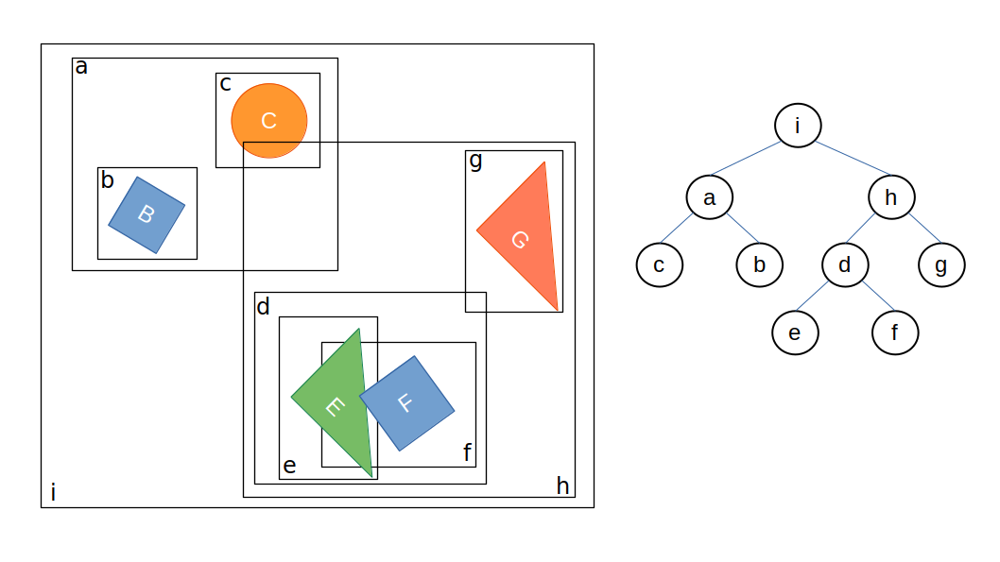

# Dynamic Tree

The dynamic tree finds objects whose axis-aligned bounding boxes overlap. These boxes have edges parallel to the world axes and are often called **AABBs**. An object tracked by the tree is called a **proxy** and implements `IDynamicTreeProxy`.

The tree groups nearby boxes so a query can skip whole groups that are out of range. Slightly expanded boxes also let objects move a short distance without needing to be reinserted every time.



## Adding proxies

All shapes added to a rigid body (`body.AddShape`) are automatically registered with `world.DynamicTree`.
Custom implementations of `IDynamicTreeProxy` can be added to the tree using `tree.AddProxy`.
In this case, a `BroadPhaseFilter` must be implemented and registered (using `world.BroadPhaseFilter`) to handle collisions with the custom proxy, otherwise an `InvalidCollisionTypeException` is thrown.

## Enumerate Overlaps

Call `tree.Update` to refresh moving objects and the set of overlapping pairs. `world.Step` does this automatically for `world.DynamicTree`. Use `tree.EnumerateOverlaps` to visit those pairs; overlapping boxes do not necessarily mean the shapes touch.

After changing a shape's geometry, call `world.DynamicTree.Update(shape)` to refresh it immediately. See [Changing an attached shape](shapes.md#changing-an-attached-shape) for the other updates needed.

## Querying the tree

Choose a query based on the result you need:

- `Query(...)` tests bounding boxes and returns objects that *might* intersect the query.
- `RayCast(...)`, `SweepCast(...)`, and `FindNearest(...)` also test the shapes and return the nearest accepted result.

### Broadphase-only queries

Find objects whose tree bounds overlap a box:

```cs
public void Query<T>(T hits, in JBoundingBox box) where T : class, ICollection<IDynamicTreeProxy>
public void Query<TSink>(ref TSink hits, in JBoundingBox box) where TSink : ISink<IDynamicTreeProxy>
```

Or find objects whose tree bounds intersect a ray:

```cs
public void Query<T>(T hits, in JVector rayOrigin, in JVector rayDirection) where T : class, ICollection<IDynamicTreeProxy>
public void Query<TSink>(ref TSink hits, in JVector rayOrigin, in JVector rayDirection) where TSink : ISink<IDynamicTreeProxy>
```

For a custom query, you can traverse `tree.Nodes` directly. This example finds bounding boxes containing a point. Only run it on a nonempty tree (`tree.Root >= 0`):

```cs
var stack = new Stack<int>();
stack.Push(tree.Root);

ReadOnlySpan<DynamicTree.Node> nodes = tree.Nodes;

while (stack.TryPop(out int id))
{
    ref readonly DynamicTree.Node node = ref nodes[id];

    if (node.ExpandedBox.Contains(point))
    {
        if (node.IsLeaf)
        {
            Console.WriteLine($"{node.Proxy} has a bounding box containing {point}.");
        }
        else
        {
            stack.Push(node.Left);
            stack.Push(node.Right);
        }
    }
}
```

### Exact query helpers

These methods use the tree to find candidates, then test their shapes. They return `true` when an accepted result is found and `false` otherwise.

#### Ray casting

All proxies implementing `IRayCastable` can be ray cast, including all shapes:

```cs
// Unbounded
public bool RayCast(JVector origin, JVector direction, RayCastFilterPre? pre, RayCastFilterPost? post,
    out IDynamicTreeProxy? proxy, out JVector normal, out float lambda)

// Bounded: only considers hits with lambda < maxLambda
public bool RayCast(JVector origin, JVector direction, float maxLambda, RayCastFilterPre? pre, RayCastFilterPost? post,
    out IDynamicTreeProxy? proxy, out JVector normal, out float lambda)
```

The ray starts at `origin` and extends along `direction`, which need not be normalized. The hit point is `origin + lambda * direction`. With a unit direction, `lambda` is the distance to the hit.

The method also returns `true` when the origin is inside a shape; in that case `lambda` is zero and `normal` is `JVector.Zero`. Use the pre- and post-filters to skip unwanted objects or hits.

#### Sweep casting

All proxies implementing `ISweepTestable` can be sweep-tested, including all shapes:

```cs
// Unbounded
public bool SweepCast<T>(in T support, in JQuaternion orientation, in JVector position, in JVector direction,
    SweepCastFilterPre? pre, SweepCastFilterPost? post,
    out IDynamicTreeProxy? proxy, out JVector pointA, out JVector pointB, out JVector normal, out float lambda)
    where T : ISupportMappable

// Bounded: only considers hits with lambda ≤ maxLambda
public bool SweepCast<T>(in T support, in JQuaternion orientation, in JVector position, in JVector direction, float maxLambda,
    SweepCastFilterPre? pre, SweepCastFilterPost? post,
    out IDynamicTreeProxy? proxy, out JVector pointA, out JVector pointB, out JVector normal, out float lambda)
    where T : ISupportMappable
```

Pass the convex query shape with its world-space `orientation` and `position`. It moves along `direction` without rotating. Its position at impact is `position + lambda * direction`.

For a sweep over a fixed distance, set `direction` to the full displacement and use `maxLambda = 1`.

`pointA` is a point on the query shape at its starting position. Move it to the impact position with `pointA + lambda * direction`. The target stays stationary during the query, so `pointB` is already its world-space contact point. `normal` is also in world space.

If the shapes already overlap, the result is `true`, `lambda` is zero, and `normal` is `JVector.Zero`. Contact points are undefined in that case.

The **pre-filter** (`SweepCastFilterPre`) receives a candidate before its shape is tested. Use it to ignore objects, such as the body being swept.

The **post-filter** (`SweepCastFilterPost`) receives the full `SweepCastResult`, including `Lambda`, `Normal`, `PointA`, and `PointB`. Use it to inspect the geometry of a hit. Returning `false` skips that result and continues the search. You can also collect results here and return `false` to keep searching.

For common built-in query shapes, convenience overloads are available:

```cs
public bool SweepCastSphere(float radius, in JVector position, in JVector direction, ...)
public bool SweepCastBox(in JVector halfExtents, in JQuaternion orientation, in JVector position, in JVector direction, ...)
public bool SweepCastCapsule(float radius, float halfLength, in JQuaternion orientation, in JVector position, in JVector direction, ...)
public bool SweepCastCylinder(float radius, float halfHeight, in JQuaternion orientation, in JVector position, in JVector direction, ...)
```

Each has a bounded variant with a `maxLambda` parameter.

#### Find nearest query

All proxies implementing `IDistanceTestable` can be distance-queried, including all shapes:

```cs
// Unbounded: considers all IDistanceTestable proxies in the tree
public bool FindNearest<T>(in T support, in JQuaternion orientation, in JVector position,
    FindNearestFilterPre? pre, FindNearestFilterPost? post,
    out IDynamicTreeProxy? proxy, out JVector pointA, out JVector pointB, out JVector normal, out float distance)
    where T : ISupportMappable

// Bounded: only considers proxies within maxDistance
public bool FindNearest<T>(in T support, in JQuaternion orientation, in JVector position, float maxDistance,
    FindNearestFilterPre? pre, FindNearestFilterPost? post,
    out IDynamicTreeProxy? proxy, out JVector pointA, out JVector pointB, out JVector normal, out float distance)
    where T : ISupportMappable
```

The query shape is defined by an `ISupportMappable` plus its world-space `orientation` and `position`.
`pointA` and `pointB` are the closest points on the query shape and the found object, in world space. `normal` is a unit vector pointing from the query shape toward that object.

An overlapping object also counts as a result. In that case `distance` is zero, `normal` is `JVector.Zero`, and the closest points are undefined. The method returns `false` when no accepted object is found within range.

The **pre-filter** (`FindNearestFilterPre`) receives a candidate before its shape is tested. The **post-filter** (`FindNearestFilterPost`) receives the calculated `FindNearestResult`. Return `false` from either to skip that candidate and continue searching.

To skip overlapping proxies and find the nearest *separated* proxy instead, reject overlap results in the post-filter:

```cs
world.DynamicTree.FindNearestSphere(radius, position,
    pre: null,
    post: result => result.Distance > 0,
    out proxy, out pointA, out pointB, out normal, out distance);
```

For common built-in query shapes, convenience overloads are available:

```cs
public bool FindNearestPoint(in JVector position, ...)
public bool FindNearestSphere(float radius, in JVector position, ...)
```

Each has a bounded variant with a `maxDistance` parameter.

### Overlap check example

To find shapes overlapping a sphere, first query its bounding box, then test each candidate against the sphere:

```cs
// Returns all RigidBodyShapes overlapping a sphere at 'center' with 'radius'.
static IEnumerable<RigidBodyShape> OverlapSphere(World world, JVector center, float radius)
{
    var queryBox = new JBoundingBox(
        center - new JVector(radius),
        center + new JVector(radius));

    var candidates = new List<IDynamicTreeProxy>();
    world.DynamicTree.Query(candidates, queryBox);

    var querySphere = SupportPrimitives.CreateSphere(radius);

    foreach (var proxy in candidates)
    {
        if (proxy is not RigidBodyShape shape) continue;

        ref var data = ref shape.RigidBody.Data;

        bool hit = NarrowPhase.Overlap(
            querySphere,
            shape,
            JQuaternion.Identity,
            data.Orientation,
            center,
            data.Position);

        if (hit) yield return shape;
    }
}
```

The bounding-box query limits the work; `NarrowPhase.Overlap` removes candidates whose boxes overlap but whose shapes do not.
