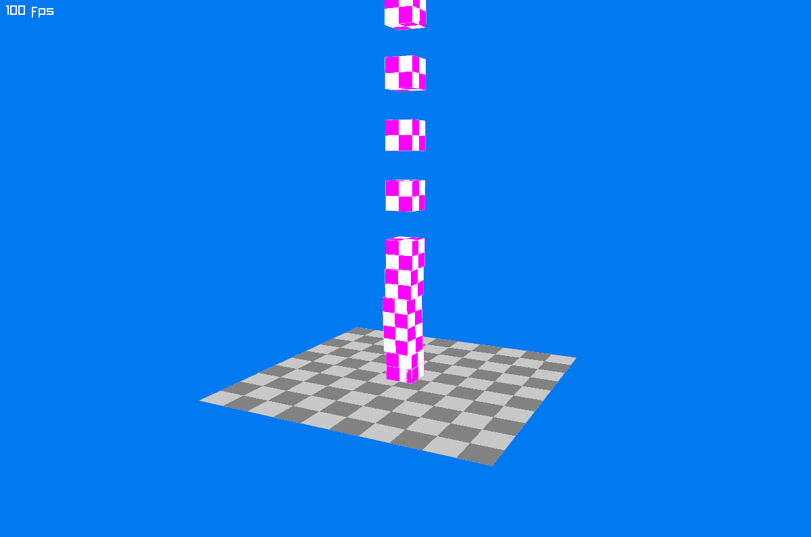

# Hello World

Now add a `World` to simulate the scene, a static body for the ground, and dynamic bodies for the boxes.

Replace the contents of `Program.cs` with the following code. The highlighted lines add the physics:

[!code-csharp]

Run the program to see boxes fall onto the ground.

