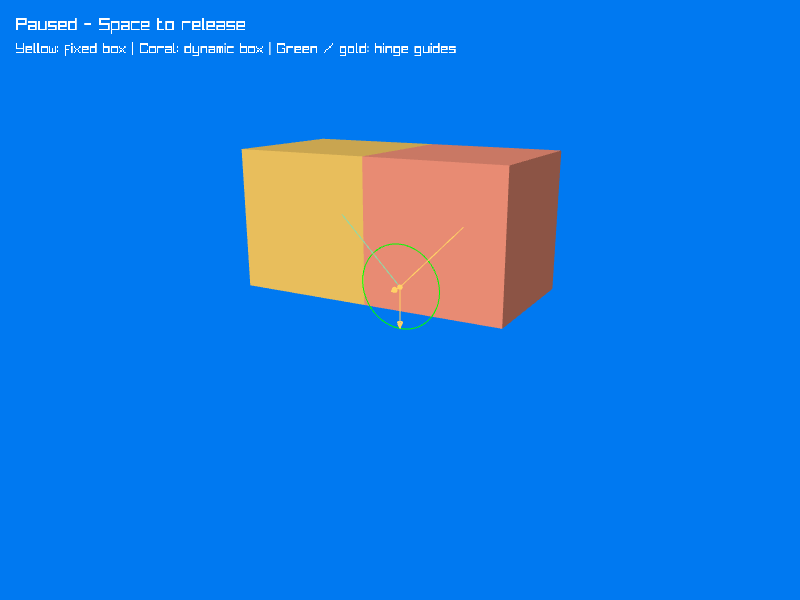

# Hello World

Now put the scene, hinge, and debug drawer together. The yellow box stays fixed while gravity swings the coral box around their shared lower edge. The boxes are filled, with green and gold hinge guides drawn on top so the anchors, axis, and current angle stay visible.



The recording holds the initial pose briefly, then runs the simulation. It loops back to the starting arrangement at the end.

## Complete code

Using the project from [Project Setup](project-setup.md), replace `Program.cs` with the following. The `RaylibDebugDrawer` class belongs **after** the top-level statements in the same file.

[!code-csharp[](snippets/Program.cs)]

## Run the example

```sh
dotnet run
```

The program starts paused so you can inspect the boxes and the hinge. Press **Space** to release the right box, and press it again to pause. Restart the program to return to the initial pose. **Escape** closes the window.

Like the earlier tutorials, this example uses `SetTargetFPS(100)` and calls `world.Step(1.0f / 100.0f, true)` once per unpaused frame. Each step advances the simulation by 0.01 seconds; `true` enables Jitter's multithreaded stepping. This simple loop runs at real-time speed when it reaches 100 frames per second and slows down if rendering falls below that target.

`using World world` releases Jitter's resources when the program exits. `CloseWindow` releases Raylib's window; this drawer owns no meshes or textures to unload.

## Try a limit

Replace the `HingeJoint` construction with the limited version from [Hinge Joint](hinge-joint.md#try-an-angular-limit-later). The box will stop near a quarter turn, and the debug guides will show the allowed range. The drawer itself needs no changes.
