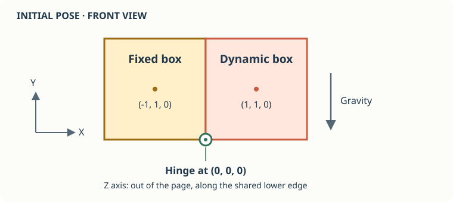

# Hinge Joint

## Arrange the bodies first

Both boxes are two units wide, high, and deep. With no initial rotation, their coordinates are:

| | Left box | Right box |
|---|---|---|
| Center | `(-1, 1, 0)` | `(1, 1, 0)` |
| X extent | `-2` to `0` | `0` to `2` |
| Y extent | `0` to `2` | `0` to `2` |
| Z extent | `-1` to `1` | `-1` to `1` |
| Motion | Static | Dynamic |

Their faces meet at `x = 0`. The lower edge of those faces is at `x = 0, y = 0`, running from `z = -1` to `z = 1`. A point on that edge is the origin, and its direction is `JVector.UnitZ`.



Create the world and bodies:

[!code-csharp[](snippets/Program.cs#L11-L22)]

`BoxShape(2)` specifies the full side length, not the half extent. Adding the shape gives the dynamic body its mass and inertia. A new body is dynamic by default; only the left body needs its motion type changed.

The static box stays in place even though there is no ground or support beneath it. Gravity acts on the right box. Four solver substeps help keep the hinge anchors together as it swings.

## Attach the hinge

[!code-csharp[](snippets/Program.cs#L24-L26)]

The anchor and axis are supplied in **world coordinates**. Create the joint after positioning the bodies: Jitter stores anchors and directions relative to them, using their initial pose as the reference.

The axis is Z, even though the boxes are arranged along X. Rotation around Z lets the right box swing in the XY plane. An axis along X would describe a different connection.

The right box's center of mass starts above and to the right of the anchor. Gravity therefore turns it clockwise in the front view shown above, while the left box stays fixed. There is no motor and no angular limit in this example. The bodies can still collide with each other; creating a hinge does not disable collision detection between them.

## What is inside a hinge?

A free body has six degrees of freedom: three translations and three rotations. This hinge is a group of two constraints:

| Constraint | What it does |
|---|---|
| `BallSocket` | Keeps the two anchor points together, removing three relative translations. |
| `HingeAngle` | Aligns the hinge axes, removing two relative rotations. |

One relative rotation remains, around Z. `HingeJoint` creates and initializes both constraints for you. They are accessible as `hinge.BallSocket` and `hinge.HingeAngle`.

To construct the same connection explicitly, **replace** the `HingeJoint` construction with:

```cs
var socket = world.CreateConstraint<BallSocket>(left, right);
socket.Initialize(hingeCenter);

var angle = world.CreateConstraint<HingeAngle>(left, right);
angle.Initialize(hingeAxis, AngularLimit.Full);
```

Do not add these on top of the joint: that would create duplicate constraints. The complete example keeps `HingeJoint`, which also gives us one object to draw.

## Try an angular limit later

After running the example, replace the hinge construction with:

```cs
var hinge = new HingeJoint(world, left, right, hingeCenter, hingeAxis,
    angle: AngularLimit.FromDegree(-90, 0));
```

The initial pose is zero. With this body order and the positive Z axis, downward rotation has a negative angle. This range lets the right box rotate down by about 90 degrees, then holds it near that limit. Constraints have finite stiffness and are solved iteratively, so small anchor separations or angular errors are normal. The debug drawing will also show the allowed angular range and its endpoints.

Next, [draw the bodies and joint](debug-drawer.md) and run the simulation.
