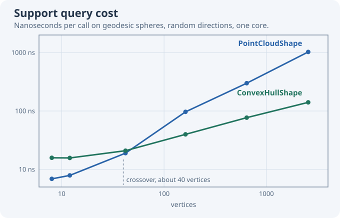

# Aftermath

### `PointCloudShape` vs `ConvexHullShape`

The example uses `PointCloudShape`, which builds a convex collision shape from a set of points. Interior points are allowed, but do not change the shape.

Both shapes answer the same support queries, in different ways. `PointCloudShape` tests every point, so a query costs more the more points there are. `ConvexHullShape` walks from vertex to neighbouring vertex towards the query direction, which costs about the same however many vertices the hull has, but it needs the triangles of the hull. Those must form the exact, closed convex hull of the points, from a tool such as Blender or a convex hull library such as [ExactHull](https://www.nuget.org/packages/ExactHull). Jitter does not generate that mesh: `ShapeHelper.Tessellate` only approximates a surface for display, and its triangles can fold and overlap, which breaks the vertex walk.

Measured with the teapot of this tutorial on a desktop CPU, as support queries in random directions and as a scene of 1000 teapots dropped into a box on four threads. The hulls are the exact hulls of the sampled points:

| shape | vertices | support query | 1000 teapots, per step |
|---|---|---|---|
| `PointCloudShape` from `SampleHull(vertices, 3)` | 131 | 79 ns | 4.1 ms |
| `ConvexHullShape`, hull of those points | 131 | 27 ns | 2.9 ms |
| `PointCloudShape` from `SampleHull(vertices, 4)` | 403 | 186 ns | 8.1 ms |
| `ConvexHullShape`, hull of those points | 403 | 51 ns | 3.9 ms |
| `PointCloudShape` from all 7850 mesh vertices | 7850 | 2800 ns | |

For small hulls the point cloud is the faster one. The chart follows both shapes over geodesic spheres from 8 to 2562 vertices: the point cloud's cost grows with the vertex count, from 7 ns to over 1000 ns, while the hull's walk grows from 16 ns to 140 ns. They cross at around 40 vertices.

As a guide, use `PointCloudShape` for hulls of up to a few dozen points and `ConvexHullShape` beyond that, and never hand a whole render mesh to a point cloud: sample it first. The numbers shift with the model and the machine, so measure your scene if collision performance matters.
