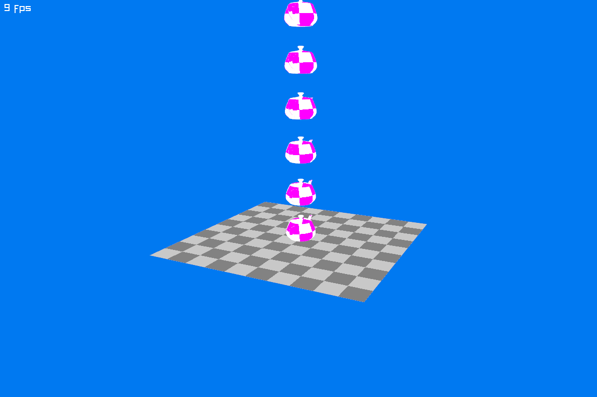

# Hello World

### Creating the `PointCloudShape`

We can now create a `PointCloudShape` from the sampled vertices:

```cs
// find a few points on the convex hull of the teapot.
var vertices = ShapeHelper.SampleHull(allVertices, subdivisions: 3);

// use these points to create a PointCloudShape.
var pointCloudShape = new PointCloudShape(vertices);
```

Jitter expects the body's center of mass at its local origin, `(0, 0, 0)`. The teapot model is offset from that origin, so using it unchanged would make the body rotate around the wrong point.

Use `PointCloudShape.Shift` to move the shape's center of mass to the origin:

```cs
// find a few points on the convex hull of the teapot.
var vertices = ShapeHelper.SampleHull(allVertices, subdivisions: 3);

// use these points to create a PointCloudShape.
var pointCloudShape = new PointCloudShape(vertices);

// shift the shape so its center of mass is at the origin.
pointCloudShape.GetCenter(out JVector centerOfMass);
pointCloudShape.Shift = -centerOfMass;

// pointCloudShape.GetCenter(out centerOfMass); // now returns (0, 0, 0)

// finally, create the rigid body for the teapot
var rigidBody = world.CreateRigidBody();
rigidBody.AddShape(pointCloudShape);
```

> [!WARNING]
> Apply the same shift when drawing the model, so the visible teapot matches its collision shape. The complete example below does this.

#### Creating Multiple Instances of the Same Shape

Each body needs its own shape instance. Use `PointCloudShape.Clone()` to create another instance that shares the same vertex data:

```cs
var shapeInstance1 = new PointCloudShape(vertices);
var shapeInstance2 = shapeInstance1.Clone(); // Safe to use in a second body
```

This lets us reuse the sampled vertices for every teapot.

### Putting it all together

Replace the contents of `Program.cs` with this complete example:

```cs
using System.Numerics;
using Raylib_cs;
using Jitter2;
using Jitter2.Collision.Shapes;
using Jitter2.Dynamics;
using Jitter2.LinearMath;
using static Raylib_cs.Raylib;

static Matrix4x4 GetRayLibTransformMatrix(RigidBody body)
{
    JMatrix ori = JMatrix.CreateFromQuaternion(body.Orientation);
    JVector pos = body.Position;

    return new Matrix4x4(ori.M11, ori.M12, ori.M13, pos.X,
                         ori.M21, ori.M22, ori.M23, pos.Y,
                         ori.M31, ori.M32, ori.M33, pos.Z,
                         0, 0, 0, 1.0f);
}

static Texture2D GenCheckedTexture(int size, int checks, Color colorA, Color colorB)
{
    Image imageMag = GenImageChecked(size, size, checks, checks, colorA, colorB);
    Texture2D textureMag = LoadTextureFromImage(imageMag);
    UnloadImage(imageMag);
    return textureMag;
}

const int numberOfTeapots = 12;

// set a hint for anti-aliasing
SetConfigFlags(ConfigFlags.Msaa4xHint);

// initialize a 1200x800 px window with a title
InitWindow(1200, 800, "TeaDrop example");

// dynamically create a plane model
Texture2D texture = GenCheckedTexture(10, 1,  Color.LightGray, Color.Gray);
Model planeModel = LoadModelFromMesh(GenMeshPlane(20, 20, 10, 10));
SetMaterialTexture(ref planeModel, 0, MaterialMapIndex.Diffuse, ref texture);

// load the teapot model from file
Model teapotModel = LoadModel("teapot.obj");

// load the mesh vertices
if (teapotModel.MeshCount == 0)
    throw new Exception("Model could not be loaded!");

Mesh teapotMesh;
unsafe { teapotMesh = teapotModel.Meshes[0]; }
var allVertices = teapotMesh.VerticesAs<JVector>();

// sample vertices on the convex hull
var vertices = ShapeHelper.SampleHull(allVertices, 4);

// create the PointCloudShape from the reduced vertices
var pointCloudShape = new PointCloudShape(vertices);

// shift the shape, such that the center of mass is at the origin
pointCloudShape.GetCenter(out JVector center);
pointCloudShape.Shift = -center;

// we need to take the transpose here, since Raylib and System.Numerics
// use a different convention
Matrix4x4 shift = Matrix4x4.CreateTranslation(-center);
shift = Matrix4x4.Transpose(shift);

texture = GenCheckedTexture(16, 2,  Color.White, Color.Magenta);
Material teapotMat = LoadMaterialDefault();
SetMaterialTexture(ref teapotMat, MaterialMapIndex.Diffuse, texture);

// initialize the Jitter physics world
World world = new ();
world.SubstepCount = 4;

// add a body representing the plane
RigidBody planeBody = world.CreateRigidBody();
planeBody.AddShape(new BoxShape(20));
planeBody.Position = new JVector(0, -10, 0);
planeBody.MotionType = MotionType.Static;

// add numberOfTeapots teapots
for(int i = 0; i < numberOfTeapots; i++)
{
    RigidBody body = world.CreateRigidBody();
    body.AddShape(pointCloudShape.Clone());
    body.Position = new JVector(0, i * 4 + 0.5f, 0);
}

// create a camera
Camera3D camera = new ()
{
    Position = new Vector3(-40.0f, 16.0f, 20.0f),
    Target = new Vector3(0.0f, 4.0f, 0.0f),
    Up = new Vector3(0.0f, 1.0f, 0.0f),
    FovY = 45.0f,
    Projection = CameraProjection.Perspective
};

// 100 fps target
SetTargetFPS(100);

// simple render loop
while (!WindowShouldClose())
{
    BeginDrawing();
    ClearBackground(Color.Blue);

    BeginMode3D(camera);

    DrawModel(planeModel, Vector3.Zero, 1.0f, Color.White);

    world.Step(1.0f / 100.0f, true);

    foreach(var body in world.RigidBodies)
    {
        if (body == planeBody || body == world.NullBody) continue; // do not draw this
        DrawMesh(teapotMesh, teapotMat, GetRayLibTransformMatrix(body) * shift);
    }

    EndMode3D();
    DrawText($"{GetFPS()} fps", 10, 10, 20, Color.White);

    EndDrawing();
}

CloseWindow();
```


