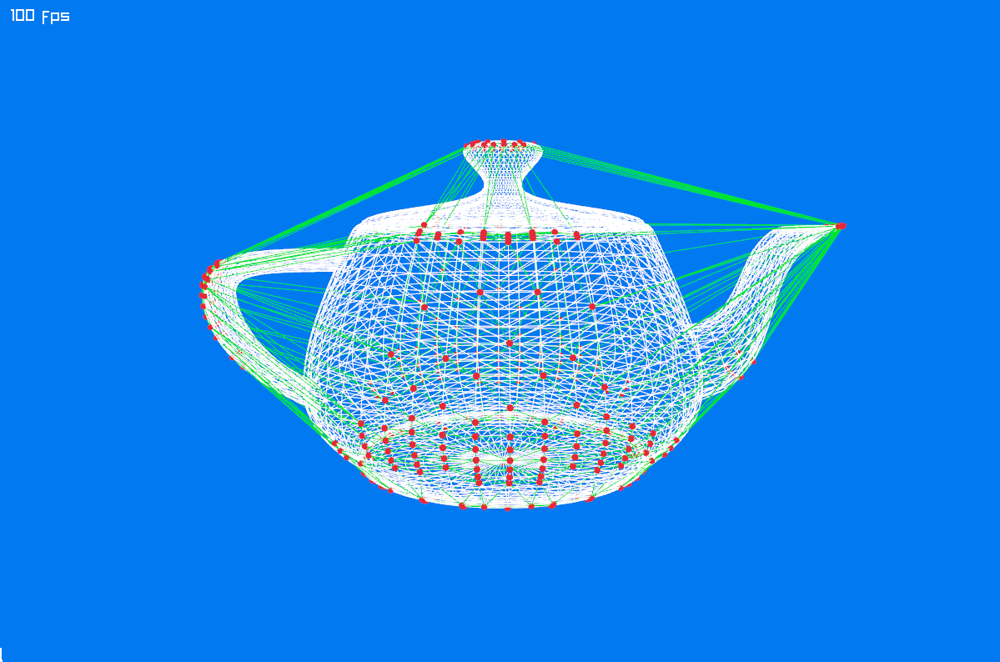

# Hull Sampling

The teapot has concave parts, such as the space under its handle. We will approximate it with a **convex hull**: imagine a tight skin stretched around the outside. The collision shape will not include those inward curves or holes.

We can reduce collision detection work by keeping only some of the model's vertices. `ShapeHelper.SampleHull` selects outermost vertices in many directions. This removes interior points and gives us a smaller set that approximates the original hull. Fewer points are faster to test, but a coarser sample can lose detail.

Replace the contents of `Program.cs` with:

```cs
using System.Numerics;
using Jitter2.Collision.Shapes;
using Jitter2.LinearMath;
using Raylib_cs;
using static Raylib_cs.Raylib;

// set a hint for anti-aliasing
SetConfigFlags(ConfigFlags.Msaa4xHint);

// initialize a 1200x800 px window with a title
InitWindow(1200, 800, "TeaDrop example");

// load the teapot model from a file
Model teapotModel = LoadModel("teapot.obj");

// load the mesh vertices
if (teapotModel.MeshCount == 0)
    throw new Exception("Model could not be loaded!");

Mesh mesh;
unsafe { mesh = teapotModel.Meshes[0]; }

var allVertices = mesh.VerticesAs<JVector>();
var vertices = ShapeHelper.SampleHull(allVertices, 4);

// just for visualization -
// we will not need to construct the explicit hull for the simulation!
var debugHull = ShapeHelper.Tessellate(vertices, 4);

// create a camera
Camera3D camera = new ()
{
    Position = new Vector3(-5.0f, 2.0f, 3.0f),
    Target = new Vector3(0.0f, 1.0f, 0.0f),
    Up = new Vector3(0.0f, 1.0f, 0.0f),
    FovY = 45.0f,
    Projection = CameraProjection.Perspective
};

// 100 fps target
SetTargetFPS(100);

// simple render loop
while (!WindowShouldClose())
{
    BeginDrawing();
    ClearBackground(Color.Blue);

    // make the scene rotate
    UpdateCamera(ref camera, CameraMode.Orbital);

    BeginMode3D(camera);

    // draw the teapot model
    DrawModelWires(teapotModel, Vector3.Zero, 1.0f, Color.White);

    // draw the sample vertices of the convex hull
    foreach (var vertex in vertices)
    {
        DrawSphere(vertex, 0.02f, Color.Red);
    }

    // for debugging: draw the explicit hull
    foreach (var vertex in debugHull)
    {
        DrawLine3D(vertex.V0, vertex.V1, Color.Green);
        DrawLine3D(vertex.V1, vertex.V2, Color.Green);
        DrawLine3D(vertex.V2, vertex.V0, Color.Green);
    }

    EndMode3D();
    DrawText($"{GetFPS()} fps", 10, 10, 20, Color.White);

    EndDrawing();
}

CloseWindow();
```



White shows the model, green shows the approximate hull, and red dots mark the sampled vertices.
